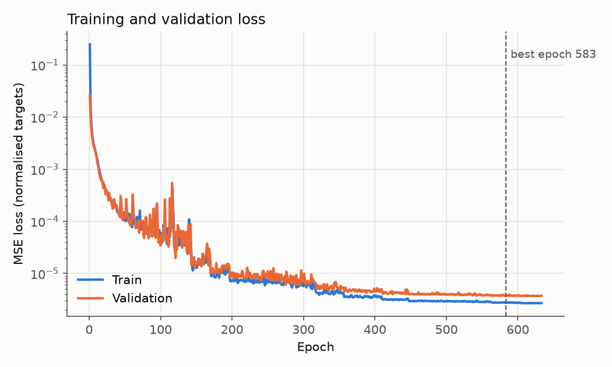
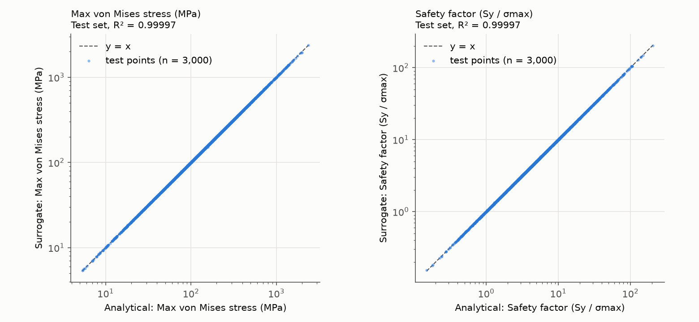

# Surrogate

A small neural network that predicts the peak stress and safety factor of a plate with a hole in about 0.1 ms, trained to replace a finite element solve that takes about 80 ms. Everything runs locally with PyTorch, NumPy, pandas, SciPy and Matplotlib. It needs no cloud services and no notebooks.

## The problem

Engineers often need the same simulation evaluated thousands of times: design sweeps, optimisation loops, Monte Carlo tolerance studies. Each FEA run costs seconds to hours, so a **surrogate model** gets trained on a set of simulation results and used in their place. It returns an answer almost instantly, as long as the query stays inside the region it was trained on.

This project builds that workflow end to end on a problem where the true answer is known, so every claim about accuracy can be checked.

**Case study: a finite-width plate with a central circular hole under axial tension.**

| Input | Range |
|---|---|
| Plate width W | 40 to 200 mm |
| Hole diameter d | 0.10 W to 0.60 W |
| Thickness t | 3 to 20 mm |
| Axial load P | 5 to 100 kN |
| Yield strength Sy | 250 to 1100 MPa |

| Output | Definition |
|---|---|
| Max von Mises stress | σmax = Kt · P / ((W − d) t), at the hole edge |
| Safety factor | Sy / σmax |

Kt is the net-section stress concentration factor from the curve fit to Howland's elasticity solution in *Peterson's Stress Concentration Factors* (Pilkey & Pilkey, Chart 4.1): Kt = 3.00 − 3.13(d/W) + 3.66(d/W)² − 1.53(d/W)³. The free edge of the hole carries only hoop stress, so the peak principal stress is also the peak von Mises stress.

## Method

1. **Ground truth that can be defended.** The labels come from the closed-form solution above. To check them independently, `src/fea.py` is a plane-stress finite element solver written from scratch: a quarter-symmetric model with Q4 elements, 2×2 Gauss integration and a mapped mesh graded toward the hole. On every run it re-solves 10 random test points. **The FE result and the analytical label agree to within 0.77%** across the full d/W range. Refining the mesh 4× (to 25k DOF) leaves the gap at about 0.4 to 0.8%, which points to the limit of the Peterson curve fit rather than discretisation error. This FE solve is also the baseline for the speedup figure, so the speedup comes from a real measurement rather than a guess.
2. **Data.** 20,000 Latin-hypercube samples over the 5-D design space, split 70/15/15 into train/val/test. Inputs are standardised. Targets are log-transformed and then standardised, because stress spans three orders of magnitude (5 to 2,400 MPa) and plain MSE would spend almost all its effort on the largest values. The scaler is fitted on the training split only and saved to `models/scaler.json`.
3. **Model.** An MLP with 3 hidden layers of 128 GELU units, mapping 5 inputs to 2 outputs: 34,050 parameters.
4. **Training.** Adam (lr 1e-3), MSE loss, batch size 256, LR halved on a 20-epoch plateau, early stopping when validation loss has not improved by 1% for 50 epochs, and the best checkpoint saved by validation loss. The seed is fixed and cuDNN determinism is on, so two runs on the same machine give identical numbers. The full dataset is kept on the device and sliced per batch, which avoids per-batch host-to-device copies.
5. **Evaluation.** The best checkpoint is reloaded and evaluated on the held-out test set in physical units (MPa, not normalised values), through the same `Surrogate` class that `predict.py` uses.

## Results

> **Hardware note.** The numbers below come from a CPU-only cloud machine (2 cores, no GPU), which I used to verify the pipeline. Accuracy does not depend on hardware. Training and inference *times* will be different on a GTX 1660 Ti, and `results/summary.json` records the hardware for each run. To be filled in: rerun `python train.py` on the 1660 Ti and replace this table with those numbers.

| Metric | Max von Mises stress | Safety factor |
|---|---|---|
| Test R² | 0.999977 | 0.999972 |
| Test MAE | 0.26 MPa | 0.013 |
| Test RMSE | 1.13 MPa | 0.073 |
| Max absolute error | 48.7 MPa | 2.77 |
| Mean relative error | 0.093% | 0.100% |
| 99th percentile relative error | 0.52% | 0.56% |
| Max relative error | 2.95% | 2.80% |

| Run summary | |
|---|---|
| Dataset | 20,000 rows (14,000 / 3,000 / 3,000) |
| Model parameters | 34,050 |
| Training time | 55 s (655 epochs, best at 605), CPU |
| Best validation loss | 2.16e-6 (normalised MSE) |
| Surrogate inference, one point, end to end | 86 µs |
| Surrogate inference, batched, per point | 0.5 µs |
| FE solve (6,370 DOF), median of 10 | 79 ms |
| **Speedup vs FE, one point** | **~920×** |
| Speedup vs FE, batched | ~160,000× |





**Reading the error numbers.** The 48.7 MPa max absolute error looks large, but it falls on a point whose true stress is about 2,000 MPa, so it is a 2.4% miss. That is why relative error is reported next to absolute error. The worst relative errors all sit at the corners of the design space: the narrowest, thinnest plates, at either the smallest or largest hole ratio. That is the expected weakness of any regressor near the edge of its training data.

## How to run

```bash
# WSL2 Ubuntu, from the repo root
python3 -m venv .venv
source .venv/bin/activate
pip install -r requirements.txt

python train.py            # generate data, train, evaluate, plot, print summary (about 1 min)
```

Predict a single design point (the analytical answer prints next to the prediction):

```bash
python predict.py --plate-width-mm 100 --hole-diameter-mm 30 --thickness-mm 8 \
                  --load-kn 40 --yield-strength-mpa 350
```

```
output                    surrogate   analytical     error
max_von_mises_mpa             167.9        167.8   +0.055%
safety_factor                 2.086        2.086   -0.000%
```

It also accepts `--json '{...}'` or `--json-file point.json`. It warns when any input is outside the training range and rejects impossible geometry (a hole wider than the plate).

Useful training flags (`python train.py --help` lists them all):

| Flag | Default | Purpose |
|---|---|---|
| `--batch-size` | 256 | Lower it if the GPU is shared and VRAM runs out |
| `--hidden`, `--layers` | 128, 3 | Model size |
| `--n-samples` | 20000 | Synthetic dataset size |
| `--device` | auto | `cuda`, `cpu`, or auto with a CPU fallback warning |
| `--data-config` | none | Train from a CSV instead of synthetic data |
| `--fea-samples` | 10 | FE re-solves for the speedup baseline (0 skips it) |

**Using a real CSV.** Write a small JSON config naming the file and its columns, then pass it with `--data-config`. `data/example_config.json` points at the CSV that `train.py` writes on each synthetic run, so it doubles as a working test of the CSV path:

```json
{
  "source": "csv",
  "path": "data/plate_with_hole.csv",
  "inputs": ["plate_width_mm", "hole_diameter_mm", "thickness_mm", "load_kn", "yield_strength_mpa"],
  "targets": ["max_von_mises_mpa", "safety_factor"],
  "target_transform": "log"
}
```

Rows with missing or non-numeric values are dropped, with a count printed. Use `"target_transform": "none"` for targets that can be zero or negative.

**VRAM.** The model weights take about 140 KB, and the whole dataset on the GPU is a few MB, so the defaults use a tiny fraction of the 1660 Ti's 6 GB. The script prints peak VRAM after training. If CUDA still runs out of memory (another program holding the GPU, for example), it exits with a message that suggests a specific smaller `--batch-size` instead of a stack trace.

## Project layout

```
train.py              entry point: data -> train -> evaluate -> plots -> summary
predict.py            single-point inference from the saved model + scaler
src/physics.py        closed-form ground truth (Peterson Kt) and input validation
src/fea.py            from-scratch plane-stress Q4 FE solver (validation + timing baseline)
src/data.py           synthetic generator, CSV loader, split, Scaler
src/model.py          the MLP
src/trainer.py        training loop, LR schedule, early stopping, checkpointing
src/inference.py      Surrogate class shared by train.py and predict.py
src/metrics.py        MAE, RMSE, max error, R², relative errors
src/plotting.py       loss curves and parity plots
data/                 example CSV config (the generated CSV is git-ignored)
models/               best_model.pt + scaler.json (committed so predict.py works right after cloning)
results/              plots, summary.json, history.csv, test_predictions.csv
```

## What I learned and limitations

- **The closed form beats the network.** Evaluating the Peterson formula takes about 0.2 µs, faster than the MLP. A surrogate only pays off when no closed form exists, as with a complex 3-D part, contact, or plasticity. I chose this problem because it has a known answer, which makes the accuracy claims checkable. It is not a problem that actually needs a neural network.
- **The speedup depends on the baseline.** The ~920× figure compares against my own 2-D linear solver with 6,370 DOF. A commercial 3-D model with meshing, a nonlinear material and post-processing takes far longer, so its speedup would be far larger, but I did not measure that and do not claim it.
- **The problem is easy for an MLP.** In log space the target is close to a sum of log-terms in the inputs, which is why R² reaches 0.99998. Real FEA data adds mesh noise, discontinuities (contact opening, buckling) and far fewer samples, because each one is expensive. R² on a realistic dataset of a few hundred FE runs would be noticeably lower, and choosing which points to simulate (active learning) would matter more than tuning the network.
- **Interpolation only.** The model knows nothing outside the box it was trained in. `predict.py` warns when an input falls outside the per-feature training range. It does not detect combinations that are individually in range but jointly unusual.
- **The physics is linear elastic.** A safety factor below 1 means the real plate would yield at the hole and redistribute stress, which this model does not capture. Neither does it cover fatigue, net-section yield or bearing failure.
- **R² alone would have hidden a real failure.** I retrained the same network on raw (not log-transformed) targets. R² barely moved (0.99996 vs 0.99998), but mean relative error rose from 0.09% to 0.73%, and the worst test point went from a 3% miss to a **50%** miss. MSE on raw stress is dominated by the 2,000 MPa cases, so low-stress designs get ignored. R² is computed the same way, so it does not notice. I now report relative error alongside R² for any target that spans orders of magnitude. To reproduce: set `"target_transform": "none"` in a copy of `data/example_config.json`.
- **Validating the labels was worth the time.** Writing the FE solver caught nothing wrong with the formula, but it turned "the ground truth is an analytical formula" into "the ground truth agrees with an independent FE model to 0.8%", and that is a much stronger statement to defend.
